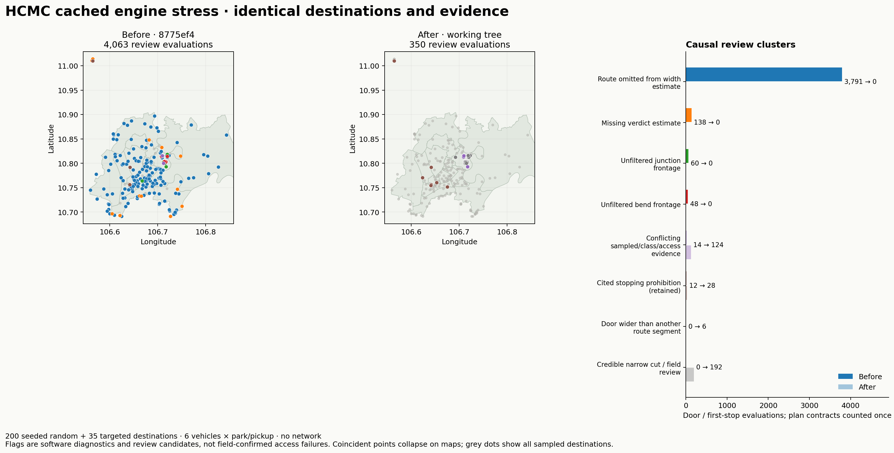

# Engine stress test — 17 October 2026

Baseline: `8775ef43ca3d0e16b079b95b3757e77164962fc7` on `hackathon-night-2026-10-17`; after: uncommitted engine changes. No commits/pushes, Gemini, Goong, Overpass or planning-portal requests; all socket connections are denied. No HTTP server was started or restarted, and :8787 was left alone. Store, flags and cached evidence live under `tmp/engine-stress/`.

## Scope and frozen inputs

**235 destinations × six vehicles × two intents = 2,820 plans per phase.** 200 random destinations: {'street': 50, 'alley': 120, 'block': 30}; 35 targeted cached narrow-cut probes, including Ministop. 185 distinct routing cells, drawn from 2,770 cached cells. The production demo graph is present before key selection, so demo/non-demo routing matches the app.

VF 3, Vios, class-m, Fortuner, Carnival and Ford Transit; park 120 min / pickup 15 min; arrival `2026-10-17T09:31+07:00`. Road samples choose an eligible way then a node in its cell. Block probes are random cell-interior points ≥8 m from mapped road centrelines, not verified entrances. Near-road initial probes are retained as extra targeted controls and replaced in the random cohort. Strata use 17 urban district polygons (2021); outside coverage, nearest-centroid district labels are explicitly recorded. No claim of uniform city coverage or field accuracy; overlapping cells and six vehicles are correlated observations.

City parcel/Declared snapshots, legacy area overlays, static vehicle/flood/field/official products and routing JSON are frozen. Legacy area records are replayed as server-owned test overlays; the current production loader rejects their old schema. No production schema/expiry policy is changed. The baseline package is exported from git into an isolated directory; the harness points both packages at the same frozen data. [Manifest](engine-stress-data/stress-inputs.json) contains file hashes. Frozen routing/evidence hashes unchanged: **True**.

## Ministop Trần Doãn Khanh

The archived [reported result](stress-known-before.json) contains `no/medium`, an Official-labelled 1.5 m hypothesis and a strict destination interval 0–5.86 m. The 1.5 m is consistent with the fallback midpoint of an unresolved survey, not the door’s own 5.56–5.65 m samples. At the requested merged HEAD, automatic parcel estimates already became Inferred; the exact old source label/verdict no longer reproduces. Instead, its estimate omits the approach/exit scope entirely.

Fresh baseline: `fits/low`; 1 estimated segment(s). After: `fits/low`; 10 arrival/exit segments. The route basis cites Cây Điệp way 35113132 at 3.58 m; the door independently cites Trần Doãn Khanh way 35115025 at 5.56 m. The sampled bottleneck band is 5.26–5.86 m. Its strict lower bound remains zero; strict fit is unknown and `verified=false`. This merged product retains Inferred provenance and low confidence, rather than promoting cadastral geometry to measured clearance. [Before](engine-stress-data/ministop-before.json) · [after](engine-stress-data/ministop-after.json).

## Rule changes and clusters

D51–D54 document the changes. Validate cached cuts before fusion; reject junction/bend frontage and >1.5 m misalignment. MAD marks an isolated low cut for confidence review. It never removes a credible constriction solely for being narrow. Confident automatic width rejection needs two consistent cut centres ≥1 m apart, within 0.6 m of the narrowest cut. Keep whole-way verification strict; expose sampled width separately, preserve the source’s own numeric value, and estimate original route objects before public serialization strips their edge IDs. Every verdict now has an estimate.

Rules are causal and deterministic; k-means/HDBSCAN would mostly cluster duplicate vehicles and mixed legitimate legal negatives. Geometry rules are reapplied equally to both phases: a raw problematic cut is flagged only if it still influences the estimate/conflict and lacks a recorded rejection. Each door/first-stop evaluation gets one primary cluster; missing-verdict contracts count once per plan. These are review diagnostics, not counts of field-proven access failures.

| Primary cluster | Before | After | Cause / action |
|---|---:|---:|---|
| Route omitted from width estimate | 3791 | 0 | Public serialization removed route edges; estimate original selected routes and partial lengths. |
| Missing verdict estimate | 138 | 0 | No projected door/stop omitted the estimate; return explicit unknown/low. |
| Unfiltered junction frontage | 60 | 0 | A cut within 5 m of a physical junction is frontage geometry; reject it and retain the diagnostic. |
| Unfiltered bend frontage | 48 | 0 | A cut within 5 m of a bend over 15 degrees is diagonal frontage; reject it and retain the diagnostic. |
| Conflicting sampled/class/access evidence | 14 | 124 | Suppress generic road-class priors for checked parcel caps; retain credible cuts and stronger access-tag conflicts for review. |
| Cited stopping prohibition (retained) | 12 | 28 | Retain the cited prohibition; a wide road does not authorize stopping. |
| Door wider than another route segment | 0 | 6 | The route and door differ; name the limiting route way and show the door samples separately. |
| Credible narrow cut / field review | 0 | 192 | Retain credible narrow geometry; sparse or uncorroborated automatic negatives stay low confidence. |



## Checks and latency

| Check | Before | After |
|---|---:|---:|
| automatic_submetre | 0 | 192 |
| basis_not_sample | 0 | 0 |
| crash | 0 | 0 |
| destination_sample_contradiction | 0 | 6 |
| door_stop_inconsistent | 0 | 0 |
| estimate_monotonicity | 0 | 0 |
| estimate_scope_missing | 3893 | 0 |
| missing_verdict_estimate | 138 | 0 |
| official_basis_without_sample | 0 | 0 |
| official_submetre | 0 | 0 |
| sample_prior_conflict | 484 | 124 |
| single_cut_confidence | 0 | 0 |
| street_sedan_no | 28 | 48 |
| unfiltered_bend_cut | 48 | 0 |
| unfiltered_junction_cut | 60 | 0 |
| unfiltered_misaligned_cut | 0 | 0 |
| unsafe_offered_stop | 0 | 0 |
| vehicle_monotonicity | 0 | 0 |
| walk_geometry_mismatch | 0 | 0 |
| walk_over_cap | 0 | 0 |

**Before**: 0 crashes; p50 **0.295 s**, p95 **2.128 s**, max 12.325 s. Four process workers, shared development machine; includes full plan/layers and trace instrumentation; graph/width caches are warm per destination. Excludes HTTP transport and one-time vehicle-envelope prewarming. Invariants: `{'missing_verdict_estimate': 138}`. Answers: `{'unknown': 423, 'fits': 1682, 'tight': 371, 'no': 206, 'missing_estimate': 138}`.

**After**: 0 crashes; p50 **0.277 s**, p95 **1.479 s**, max 3.944 s. Four process workers, shared development machine; includes full plan/layers and trace instrumentation; graph/width caches are warm per destination. Excludes HTTP transport and one-time vehicle-envelope prewarming. Invariants: `{}`. Answers: `{'unknown': 472, 'fits': 1586, 'tight': 506, 'no': 256}`.

Full-profile dominance compares mirror width, length and turning radius only when the smaller profile’s water tolerance is no worse. Same-path estimate/confidence monotonicity and progressive consistent evidence are also checked by the active estimate tests. Offered stops are checked for walk caps, geometry-plus-connector metres, fit exclusions, a Way Out, reverse limits and verdict/first-stop agreement.

## Regressions and handoff

`backend/tests/test_engine_quality.py` freezes Ministop plus ten distinct worst sampled door ways from the baseline (junction first, then extreme narrow conflicts). Self-contained cached geometry/cuts are in `backend/tests/fixtures/engine_regressions.json`; tests need no private runtime caches. Additional tests cover credible MAD outliers, independent/duplicate cut support, numeric-string caches, the unresolved Official midpoint, legacy single-cut confidence, route partial lengths and empty-network estimates. Current core tests: **69 passed, 1 skipped, 1 warning in 9.06s**. Full backend suite: **330 passed, 77 skipped, 2 warnings, 210 subtests passed in 192.16s (0:03:12)**. Network connections are denied, and writable backend paths are isolated. Parked prototype suites retain the repository’s default skips. [Core log](engine-stress-core-tests.txt) · [Full backend log](engine-stress-backend-final-tests.txt). The frozen quality regressions against the baseline produced **19 failures / 5 passes** before the citation-only test additions; all current quality regressions pass. [Baseline regression log](engine-stress-regressions-before.txt).

English migration: all controlled copy in the owned engine files is English; real street names and legal citations remain verbatim. Rule summaries are English. The adapter, estimate basis and Restricted verdict each have citation regressions for the full law and QCVN citation. The remaining-string inventory in [Agent D’s English handoff](english-ui-handoff.md) was checked: dictionary inputs, generic-name matching, brands and identifiers are intentional. Legacy free-text evidence notes/source titles not recognized by the centralized adapter remain original text. The follow-up extension point is `ENGLISH_TEXT` / `ENGLISH_PREFIXES` / `ENGLISH_FRAGMENTS` in `evidence.py`. [Agent integration handoff](engine-agent-handoff.md) records the English caveat test update and a legacy null compact-flood renderer edge case.

Changed engine files: `backend/app/plan.py`, `backend/app/evidence.py`, `backend/app/width_samples.py`. Added the regression module/fixture and `pipelines/stress_engine.py`; appended D51–D54 and these eval artifacts. Updated English-copy assertions in `test_engine_estimate.py`, `test_evidence_safety.py` and `test_plan_boundaries.py`. No geocoding, agent/search, frontend, MCP, portal transport or parcel-fetch code was edited by this task. Other agents’ shared-workspace changes are outside this report.

Backend/API integration exposes `fit.width_range.sampled_estimate` and `estimate.stop_width`; strict `lo/hi` retain their safety meaning. The existing Result/Evidence width labels still format strict `lo/hi`; a frontend follow-up must wire the sampled band for estimate display (labelled sampled/unverified), while retaining strict bounds for clearance decisions. No frontend code was edited under Agent B ownership. The shared :8787 process has not reloaded these Python changes; its owner must reload it when coordinating the team handoff.

Reproduce on the frozen runtime (network denied by the script):

```sh
python3 pipelines/stress_engine.py freeze --n 200 --seed 171026
ENGINE_STRESS_BACKEND="$PWD/tmp/engine-stress/baseline-backend" python3 pipelines/stress_engine.py run --phase before --workers 4
python3 pipelines/stress_engine.py run --phase after --workers 4
python3 pipelines/stress_engine.py report
```

The isolated baseline package is a byte-for-byte export of `backend/app` from 8775ef4; it is not a worktree checkout. Raw plan summaries are `engine-stress-data/stress-{before,after}.jsonl.gz`; the smaller `features-{before,after}.jsonl.gz` record class/highway, district, cut-to-junction distance, cuts per way, tiers, vehicle class, door/stop scope, coverage and sample-quality diagnostics. Aggregate results are in [summary.json](engine-stress-data/summary.json).
