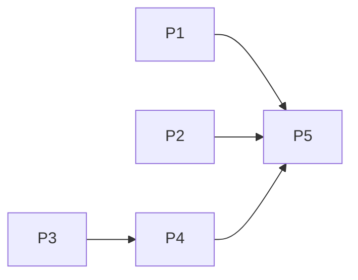

# Vào Được: 3 feature demo

## Overview
Nguồn quyết định: `plans/reports/advise-261014-1925-top3-demo-features.md` (đã chốt với user), ý tưởng gốc `plans/reports/research-261014-1918-map-inspired-features.md`.

- **Outcome:** demo 3 khoảnh khắc: *trước khi đi* thấy xe mình trong hẻm + mô phỏng quay đầu (laptop); *đang đỗ* điện thoại báo phải rời trước khi ngập; *sau khi ra* nói một câu → xác nhận có cấu trúc chờ duyệt (điện thoại).
- **Constraints:** không đổi `strict`, `decisive_clearance`, `turn_verified`; mọi bằng chứng mới qua `reports.submit` + operator; mỗi feature có fallback khi mạng/Gemini lỗi; chạy cả điện thoại lẫn laptop; khu demo cố định + live.
- **Non-goals:** clip/dashcam, 3D tòa nhà, Street View, Web Push server, "Hỏi Vào Được".
- **Liên quan:** `plans/261010-1154-access-safety-hardening` (4/5 phase xong) giữ hợp đồng an toàn mà plan này phải tôn trọng; không chặn nhau, phase 3 chạm `evidence.py` → rebase nếu hardening còn sửa file đó.

## Goals
| # | Goal | Priority |
|---|------|----------|
| 1 | Bóng xe đúng tỉ lệ trong dải bề rộng + mô phỏng quay đầu theo `lo` | P1 |
| 2 | Cảnh báo giờ về khi đường ra sắp ngập | P1 |
| 3 | Xác nhận có cấu trúc (vào/ra) + fix thân hẹp nhất của nhóm | P1 |
| 4 | Nhập xác nhận/vật cản bằng giọng nói | P2 |
| 5 | Kịch bản demo 3 × 90 s + smoke 2 thiết bị | P1 |
| 6 | Kết quả dễ quét: quyết định trước, chi tiết bằng chứng theo yêu cầu | P1 |

## Phases
| # | Phase | Status |
|---|-------|--------|
| 1 | [Phase 1: Bóng xe + mô phỏng quay đầu](./phase-01-car-footprint-maneuver.md) | Pending |
| 2 | [Phase 2: Cảnh báo giờ về](./phase-02-departure-watch.md) | Pending |
| 3 | [Phase 3: Xác nhận có cấu trúc](./phase-03-structured-confirmation.md) | Pending |
| 4 | [Phase 4: Báo bằng giọng nói](./phase-04-voice-report.md) | Pending |
| 5 | [Phase 5: Kịch bản demo + smoke](./phase-05-demo-script-and-smoke.md) | Pending |

P1, P2, P3 song song; `Result.tsx` và `App.tsx` có một người tích hợp.

## Success Criteria
- [ ] `PYTHONPATH=backend .venv/bin/python -m unittest discover -s backend/tests -p 'test_*.py'` xanh; test mới: claim xác nhận/exit không đổi `compute_fit`, `_way_out.strict`, `turn_verified`.
- [ ] Xác nhận "in" với `class-l` → bound `lo = 1.94` (không còn 2.265).
- [ ] Bóng xe hiện ≤ 1 s sau khi chọn điểm dừng; mô phỏng quay đầu ≤ 300 ms khi cache nóng.
- [ ] Bật mưa giả lập sau khi theo dõi preset khô → banner ≤ 60 s; nếu người dùng cấp Notification permission, notification hệ thống cũng tới ≤ 60 s.
- [ ] Trạng thái watch xấu đi, hồi phục, rồi xấu lại → gửi cảnh báo mới một lần; trạng thái không đổi không spam.
- [ ] Câu nói "vào được nhưng phải gập gương, ra phải lùi" → report `confirmation` pending với `result=tight`, `exit=reversed`.
- [ ] Footprint uses the dimensions and body-centre offset of the specific simulated profile/member.
- [ ] Voice parser has an independent 20 requests/client/hour quota and 10 s total model deadline; timeout/provider-shape failure returns `unclear`.
- [ ] Main-road stop confirmation returns a clear 422 and creates no pending report; confirmations are only for server-mapped alley stops.
- [ ] Kết quả mặc định gọn: verdict, điểm dừng, 4 trạng thái và cảnh báo thiết yếu; chi tiết bề rộng/ngập/pháp lý/nguồn mở được, không bị bỏ.

## Implementation Status (2026-10-15)
- Code for phases 1–5 written; docs/demo-script.md exists. Checkboxes intentionally left unticked: they are acceptance items, not all proven.
- Verified: 137/137 backend unittest + `npm run build` (before the last edit batch); BSK desktop smoke (compact result, maneuver panel, watch alert/recovery/recurrence, voice manual fallback, report 202).
- NOT verified after last batch (pose recentering `x - D/2`, 5 m/`is_alley` confirm gate + its 2 new fixtures, operator summary, lot-stop gating, unavailable reasons, `simulated_vehicle_label`): rerun unittest + build first.
- NOT verified at all: physical Android Chrome, OS-level Notification delivery, trajectory overlay alignment on a stop that yields a real path, 3×90 s demo runs, Gemini-blocked rerun.
- Known residual (documented, unfixed by decision): class maneuver cold-cache CPU/non-atomic `three_point.json` write; `vehicles.py:112` ResourceWarning; 1.38 MB bundle.

## Validation Log

### Session 1 — 2026-10-14
**Trigger:** `/ak:plan validate` sau khi tạo plan.
**Questions asked:** 3

#### Verification Results
- **Tier:** Full (5 phase; Fact Checker, Flow Tracer, Scope Auditor, Contract Verifier)
- **Claims checked:** 38
- **Verified:** 36 | **Failed:** 1 | **Unverified:** 1
- Verified mẫu: `geometry.k_turn` (`geometry.py:67`, 1 caller `geometry.py:113`); `vehicles._members` (`vehicles.py:176`); `three_point_width` worst-case member (`vehicles.py:199-207`); `storage.LRU` (`storage.py:45`); `plan.layers.fit` features có `way_id` + `lo/hi` (`plan.py:1319-1323`); stop point có `way_id`, `verified` (`plan.py:938-939`); `way_out.flood` (`plan.py:883`); `api.plan` (`api.ts:248`); `rainOn` (`App.tsx:31`); `Confirmation` (`main.py:401`), `_graph_with` (`main.py:382`); approve → `STORE_EVIDENCE.reload()` (`main.py:463-465`); `_project_line` giữ payload (`reports.py:160-161`); `ai._call`/`_gate`/`NoModel` (`ai.py:67,129,72`); `allow_guest` (`reports.py:86`); `DEMO_CENTER` (`main.py:36`); `npm run build` (`frontend/package.json`).
- Contract Verifier: `api.confirm` 1 caller (`App.tsx:330`); `/api/confirm` dùng trong `test_operator_access.py:101-106`; `_load_confirmations` 1 caller (`evidence.py:270`); `CONFIRM_FILE` đọc ở `evidence.py`, `test_api_validation.py:138`.
- Scope Auditor: cache maneuver là process-global nhưng thuần (input → output), không rò state; phiên đỗ nằm ở `localStorage` trình duyệt (repo chưa dùng `localStorage`, không trùng state).

#### Failures
1. [Fact Checker/Flow Tracer] Phase 3 giả định client có `route_in.way_ids`/`way_out.way_ids`; thực tế `_public_route` (`plan.py:739-741`) xóa `way_ids` khỏi response. → Đã sửa theo câu trả lời Q1.

#### Unverified
1. Hỗ trợ Notification/SpeechRecognition tiếng Việt trên iOS Safari — không kiểm được tại chỗ; loại khỏi phạm vi demo theo Q3.

#### Questions & Answers
1. **[Architecture]** Lấy way_ids của đường vào/ra cho xác nhận bằng cách nào (client không nhận way_ids do `_public_route`)?
   - Options: Server tự tính từ toạ độ điểm dừng | Trả way_ids ra client và tin client | Giữ như cũ: chỉ door way
   - **Answer:** Server tự tính từ toạ độ điểm dừng
   - **Rationale:** giữ nguyên tắc "bằng chứng do server sở hữu" của nhánh hardening.
2. **[Scope]** Phase 1 có thêm cung rẽ vào ở đầu hẻm không?
   - Options: Không, giữ 2 hình | Có, thêm cung rẽ vào
   - **Answer:** Không, giữ 2 hình
   - **Rationale:** tránh hình học sai ở nút giao; đủ wow.
3. **[Assumptions]** Điện thoại demo?
   - Options: Android + Chrome | iPhone | Có cả hai
   - **Answer:** Android + Chrome
   - **Rationale:** Notification và STT tiếng Việt không cần PWA.

#### Confirmed Decisions
- way_ids xác nhận: server tính bằng `parcels.path_into`/`path_out` từ toạ độ điểm dừng; bỏ `way_ids` khỏi request `/api/confirm`.
- After code review 2026-10-15: confirmation width evidence applies only to the terminal way of server-computed `path_into` (the OSM way containing the stop); egress observations remain server-computed. Do not apply a driver report to every candidate ingress segment.
- Phase 1: chỉ bóng xe + quay đầu.
- Thiết bị demo điện thoại: Android + Chrome.

#### Impact on Phases
- Phase 1: thêm dòng ngoài phạm vi (cung rẽ vào).
- Phase 2, 4: risk ghi rõ thiết bị Android + Chrome.
- Phase 3: đổi request `Confirmation`, server tính way_ids, thêm `test_operator_access.py` vào file cần sửa; sửa đánh giá rủi ro cận trên (lỏng = an toàn).

### Whole-Plan Consistency Sweep
- Files reread: plan.md, phase-01-car-footprint-maneuver.md, phase-02-departure-watch.md, phase-03-structured-confirmation.md, phase-04-voice-report.md, phase-05-demo-script-and-smoke.md, `plans/reports/advise-261014-1925-top3-demo-features.md`
- Decision deltas checked: 3
- Reconciled stale references: 4 (phase 3 overview/steps/criteria, phase 3 bracket note, advise report "Nên làm 1" + checklist P3)
- Unresolved contradictions: 0

<!-- slug: demo-wow-features -->
