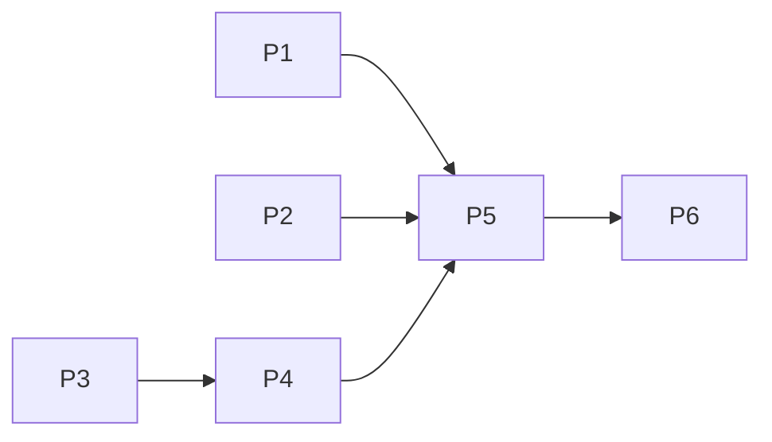

# Vào Được: demo features và Gemini voice

## Overview
Nguồn quyết định: `plans/reports/advise-261014-1925-top3-demo-features.md` (đã chốt với user), ý tưởng gốc `plans/reports/research-261014-1918-map-inspired-features.md`.

- **Outcome:** giữ ba luồng demo hiện có; bổ sung nói để cập nhật chuyến đi và hoàn thiện voice báo cáo. Gemini chép audio thành transcript sửa được; thay đổi chỉ có hiệu lực sau Áp dụng/Gửi.
- **Constraints:** không đổi `strict`, `decisive_clearance`, `turn_verified`; báo cáo qua `reports.submit` + operator. Gemini key backend-only, user cung cấp sau; audio không lưu lâu dài trong app. Không coi transcript/model confidence là bằng chứng.
- **Non-goals:** clip/dashcam, 3D tòa nhà, Street View, Web Push server, chatbot "Hỏi Vào Được", Gemini Live/realtime, TTS, wake word/luôn nghe, voice tự duyệt báo cáo hoặc tự đổi kết luận an toàn.
- **Liên quan:** `plans/261010-1154-access-safety-hardening` giữ safety contract; phases 1–4 đã hoàn tất, phase 5 thực địa/release còn mở. Voice dùng code đã có, không cần đợi field survey để triển khai; không thay field/evidence/geometry. Hai plan không block nhau; mọi release chung vẫn phải giữ acceptance hardening chưa đóng.

## Goals
| # | Goal | Priority |
|---|------|----------|
| 1 | Bóng xe đúng tỉ lệ trong dải bề rộng + mô phỏng quay đầu theo `lo` | P1 |
| 2 | Cảnh báo giờ về khi đường ra sắp ngập | P1 |
| 3 | Xác nhận có cấu trúc (vào/ra) + fix thân hẹp nhất của nhóm | P1 |
| 4 | Nhập xác nhận/vật cản bằng giọng nói | P2 |
| 5 | Kịch bản demo 3 × 90 s + smoke 2 thiết bị | P1 |
| 6 | Kết quả dễ quét: quyết định trước, chi tiết bằng chứng theo yêu cầu | P1 |
| 7 | Map-first polish + one complete physical-access path with width/entry/exit evidence; parking law remains evidence-driven | P1 |
| 8 | Gemini audio → transcript sửa được, không phụ thuộc SpeechRecognition | P1 |
| 9 | Nói để đổi xe/đích đến/mục đích/giờ đến/thời lượng, xem lại rồi áp dụng | P2 |

## Phases
Danh mục gốc 1–6 bên dưới được giữ nguyên. Phases 7–9 được scaffold bằng CLI; mục **Voice extension** là index bổ sung. `ak plan status` đọc cả 9 phase files; không coi bảng lịch sử 1–6 là toàn bộ tiến độ.

| # | Phase | Status |
|---|-------|--------|
| 1 | [Phase 1: Bóng xe + mô phỏng quay đầu](./phase-01-car-footprint-maneuver.md) | In progress (5/6) |
| 2 | [Phase 2: Cảnh báo giờ về](./phase-02-departure-watch.md) | In progress (4/5) |
| 3 | [Phase 3: Xác nhận có cấu trúc](./phase-03-structured-confirmation.md) | Completed (6/6) |
| 4 | [Phase 4: Báo bằng giọng nói](./phase-04-voice-report.md) | Completed (6/6) |
| 5 | [Phase 5: Kịch bản demo + smoke](./phase-05-demo-script-and-smoke.md) | In progress (1/3) |
| 6 | [Phase 6: UI polish and synthetic demo data](./phase-06-ui-polish-and-synthetic-demo-data.md) | In progress (3/4) |

P1, P2, P3 song song; `Result.tsx` và `App.tsx` có một người tích hợp.

## Voice extension — quyết định ngày 2026-10-17

User chọn **tiếp tục plan demo**, phạm vi **cập nhật chuyến đi + báo cáo**; sau đó chọn **Gemini API audio**, cung cấp key sau. Không mở lại phase 4 đã hoàn tất: phase 4 là baseline SpeechRecognition, phase 7 clean-cutover sang recorder/Gemini.

### Phạm vi và ý tưởng đã chốt
- **Đổi xe + thời lượng:** “Đổi sang Toyota Fortuner, đỗ xe hai tiếng” → review xe trong catalogue + 120 phút; Áp dụng mới tính lại.
- **Đổi điểm đến:** “Đổi điểm đến sang Hẻm 160 Ngô Tất Tố” → tìm/chọn địa chỉ trong draft, không để model bịa tọa độ.
- **Đổi mục đích/giờ:** “Chỉ dừng đón khách” hoặc “Đến 18 giờ ngày mai” → review intent và ngày giờ Việt Nam rõ ràng; câu mơ hồ hỏi lại.
- **Báo hiện trường:** “Vào được nhưng phải gập gương, ra phải lùi” / “Đầu hẻm có xe ba gác chắn” → confirmation/blockage review → Gửi → pending, không tự công bố Evidence.

### Brainstorm kỹ thuật
| Cách làm | Điểm phù hợp | Trường hợp thất bại đầu tiên | Quyết định |
|---|---|---|---|
| Browser SpeechRecognition | Đã có code, ít thay đổi backend | Hỗ trợ/ngôn ngữ/dịch vụ STT phụ thuộc browser; không kiểm soát provider | Không chọn làm hướng mới; bỏ implementation khi phase 7 cutover, không giữ hai STT path |
| MediaRecorder + Gemini Audio clip ngắn | Kiểm soát provider/key/quota; dùng chung audio cho trip/report | Thiếu mic permission, format/decoder, key/model hoặc mạng; có chi phí và data-use terms | **Chọn theo user**; transcript trước, text parser sau, mọi action cần review |
| Gemini Live realtime | Hội thoại hai chiều liên tục | Session/streaming/audio output/auth/cost lớn hơn nhu cầu sửa form | Không chọn; user không yêu cầu trợ lý realtime |

Giữ nguyên việc không thêm voice flood/stop-rule ingestion hoặc router/service mới. Voice extension nay gồm phases 7–10; ba production files hiện có trong phase7–8 giữ nguyên, phase10 thêm `frontend/src/components/VoiceReroute.tsx` và dùng route alternatives hiện có; không thêm provider SDK. Phase10 chỉ reroute theo lệnh tường minh, không cung cấp turn-by-turn navigation.

### Requirements
| ID | Yêu cầu và bằng chứng hoàn tất | Phase |
|---|---|---|
| V-01 | Bấm ghi clip tiếng Việt → explicit gửi Gemini → transcript sửa được; không tự upload khi stop/cancel; không phụ thuộc SpeechRecognition | 7, 8, 9 |
| V-02 | Confirmation đúng xe/stop; blockage tọa độ/way khớp projection server và queue có context để duyệt; explicit Gửi mới pending, không dùng chip cũ | 7, 9 |
| V-03 | Voice sửa vehicle, destination, intent, arrival, dwell; field không nói giữ nguyên; draft diff trước Áp dụng | 8, 9 |
| V-04 | Xe khớp catalogue, địa chỉ qua search/detail và chọn thật; chỉ một batch commit/recompute, không tự gọi plan khi parse | 8, 9 |
| V-05 | Ngày/giờ VN +07 rõ ràng, dwell integer 1..10080; pickup đánh giá 15 phút; mơ hồ/xung đột → hỏi/sửa, không đoán hoặc commit phần đúng | 8, 9 |
| V-06 | Fallback gõ/chip; audio→Gemini và text→provider/model được disclose riêng; server-only keys/paid-confirmation, không lưu audio lâu dài; watch giữ identity cả demo_scenario | 7, 8, 9 |
| V-07 | Context/transcript revision chống response cũ; constructor/start/error/close/hidden đều dừng mọi mic track; không gửi/áp draft lặp | 7, 8, 9 |
| V-08 | Flags off;20 requests/IP/h +global persistent60/h, attempt caps;≤1MiB/20s;2-slot admission và deadline15s từ trước upload; status429 budget/424 config/408 slowupload, không bypass Operator/safety | 7, 8, 9 |
| V-09 | API/race smoke và paid Android/Gemini proof riêng; rawSTT≥8/9, parser-uncorrected≥8/9, reviewed9/9; missing key/tier giữ live gate mở; docs sau smoke | 9 |
| V-10 | Lệnh thoại reroute tường minh → foreground GPS fix tươi → tính/chọn tuyến hiện có → đọc phản hồi; lỗi GPS, dữ liệu giao thông không rõ hoặc tuyến không an toàn không đổi tuyến âm thầm | 10, 9 |

### Phases bổ sung và dependencies
7. [Gemini audio và ngữ cảnh báo cáo](./phase-07-voice-capture-and-report-context.md) — pending; cần baseline phase 4 đã completed.
8. [Voice trip draft và áp dụng thay đổi](./phase-08-voice-trip-draft-and-apply.md) — pending; cần7. Thêm trip-only endpoint; confirmation không đổi. Report parse failures migrate theo status matrix; blockage vị trí được siết ở phase7 theo review đã duyệt.
9. [Voice acceptance và kiểm chứng thiết bị](./phase-09-voice-acceptance-and-device-proof.md) — pending; cần 7, 8, 10. Kết quả mock không thay micro/Gemini live.
10. [Voice-requested rerouting](./phase-10-voice-requested-rerouting.md) — pending; cần 7, 8. Dùng Gemini transcription chung và `/api/corridor`; foreground one-shot GPS, browser speech synthesis; không thêm continuous navigation.

Thực hiện 7 → 8 → 10 → 9; một integration owner cho `App.tsx`, `api.ts`, `main.py`, `flags.py`, API tests. Phases 1/2/5/6 vẫn mở như cũ; không tự đóng vì extension xong. Không có cross-plan blocker mới: hardening phase 5 không cấp đầu ra bắt buộc cho voice; release thực địa/hosting vẫn là gate độc lập.

### Luồng thực hiện
`Ghi âm theo lệnh → Gemini transcription → xác định reroute → lấy GPS hiện tại → corridor route alternatives → chọn tuyến có dữ liệu đủ an toàn → đọc phản hồi`.

Speech synthesis chỉ phát phản hồi ngắn trong trình duyệt; không dùng Gemini Live, không nghe nền. Route result có thể nêu chưa rõ nếu camera cũ/thiếu; không được khẳng định đã né kẹt.

Hai lượt AI có chủ đích: tách STT khỏi extraction để tái dùng schema/report parser và cho người dùng sửa số, tên xe/địa chỉ trước khi hiểu intent. Reroute chỉ gọi corridor sau lệnh rõ, không sửa destination/vehicle/intent hay gửi evidence. Audio flag `ai_voice_input`, report flag `ai_voice_report`, trip flag `ai_voice_trip`; các cờ vẫn default off.

### Bằng chứng khảo sát phiên này
- CLI trước extension: demo 2/6 phase completed, 25/30 checkbox (83%); hardening 4/5, 11/13 (84%). Đây là trạng thái checkbox, không phải tỷ lệ feature live/production-ready. Snapshot trước extension được giữ ở Implementation Status phía dưới.
- Source anchors và contracts hiện tại nằm trong Current Behavior của phases 7–9. Source/instructions discovery không tìm thấy AGENTS.md/CLAUDE.md trong project/ancestor đã kiểm; dùng README, CONTEXT và design-system docs.
- Smoke actual FastAPI TestClient trong subprocess, temp store/cache/flags, không credentials/network: `/api/voice/parse` flag off→403; no provider→200 unclear; text301→422; pending reports rỗng. Không chạy lại full test/build và không tuyên bố micro/Gemini live đã thử.
- Host có ffmpeg; Gemini audio docs xác nhận transcription/inline audio. Key/model access/tier, thiết bị Android và HTTPS demo [UNVERIFIED], user cung cấp key sau.
- Hai researcher jobs không khởi động (“No model selected”), model override bị tool từ chối; primary-doc research thực hiện inline. Auto-detected hard; sau đó **3 code-reviewer jobs chạy thành công**,10 findings (8High/2Medium). User duyệt áp dụng có điều chỉnh và xác minh paid tier trước human audio; [adjudication](./reports/voice-red-team-261017.md).
- Plan files là deliverable; chưa triển khai code ứng dụng. Session hook không có CK_SESSION_ID; worktree pointer dùng `ak plan use`, không khẳng định session pointer đã lưu.
- Audio feasibility smoke (không Gemini): tạo WebM/Opus synthetic tone trong memory, decode bằng ffmpeg pipe/protocol whitelist →10,122 bytes encoded,32,000 PCM bytes =1 s mono16kHz; không tạo file audio. Chỉ chứng minh container-normalization path, không STT quality.
- `ak plan validate` pass; `ak plan reindex --apply` nhận9 phases; `ak plan status`:2/9 completed,25/39 checkbox (64%). Tỷ lệ giảm từ83% vì thêm9 acceptance mới, không phải mất phần đã xong. Check cơ học phases7–9: đủ sections, mọi implementation step map V-ID, mọi Modify/source anchor tồn tại và trong line bounds;0 lỗi.

### Whole-plan consistency — extension
- Đã đối chiếu overview và cả phases1–9: giữ completed phase3/4; phase4 đánh dấu baseline bị phase7 thay capture, phase5 tách LAN/fixture khỏi Gemini mic proof.
- Quyết định đồng bộ sau review: Gemini recorder, transcript/parse tách;3 flags;20/IP vàglobal60/h persistent; paid status trước human audio; hai model/provider readiness; blockage mapped location; saved-watch demo_scenario.
- Audio deadline15s từ route entry gồm upload,2 slots giữ qua cleanup; response cleanup có thể muộn hơn budget. Text10s giữ deadline mechanism hiện có. Status matrix429 budget/424 config/408 upload không bị gộp thành semantic unclear. Không coi typed/mock/emulation là voice proof.
-10 review decision deltas đã áp dụng; không còn mâu thuẫn quyết định chưa xử lý trong extension. Historical source anchors/logs giữ là snapshot, không phải current API contract.

### Nguồn kỹ thuật
- [Gemini audio understanding](https://ai.google.dev/gemini-api/docs/audio), [structured output cần semantic validation](https://ai.google.dev/gemini-api/docs/structured-output), [data-use terms](https://ai.google.dev/gemini-api/terms).
- [MediaRecorder](https://developer.mozilla.org/en-US/docs/Web/API/MediaRecorder), [getUserMedia/HTTPS/permission](https://developer.mozilla.org/en-US/docs/Web/API/MediaDevices/getUserMedia).

## Red Team Review — Gemini voice extension, 2026-10-17
3 reviewers độc lập: Security Adversary, Failure Mode Analyst, Assumption Destroyer/Contract Verifier.10 findings:8High/2Medium;10 accepted (trong đó quota/public-access khuyến nghị được điều chỉnh để dùng persistent global cap + per-IP hiện có, không thêm identity/token system). User đã chấp thuận chỉnh sửa và paid-tier prerequisite. Chi tiết evidence/disposition: [voice-red-team-261017.md](./reports/voice-red-team-261017.md).

### Whole-Plan Consistency Sweep
- Scope: plan.md và toàn bộ phases1–9; phase4 baseline và phase5 device path đã đối chiếu với extension7–9; hardening overlap note cũng cập nhật.
- Decision deltas:10; các điểm cần đồng bộ: upload deadline/admission, quota semantics/global persistence, paid tier, blockage API/queue, response matrix, mic failure cleanup, watch identity, audio/text readiness, deploy preflight, raw quality floor.
- Không mở lại phase completed hoặc đóng acceptance cũ; voice mới9 checkbox vẫn pending. Không có contradiction chưa giải quyết; chưa có Gemini/live implementation proof.

## Success Criteria
- [ ] `PYTHONPATH=backend .venv/bin/python -m unittest discover -s backend/tests -p 'test_*.py'` xanh; test mới: claim xác nhận/exit không đổi `compute_fit`, `_way_out.strict`, `turn_verified`.
- [x] Xác nhận "in" với `class-l` → bound `lo = 1.94` (không còn 2.265).
- [ ] Bóng xe hiện ≤ 1 s sau khi chọn điểm dừng; mô phỏng quay đầu ≤ 300 ms khi cache nóng.
- [ ] Bật mưa giả lập sau khi theo dõi preset khô → banner ≤ 60 s; nếu người dùng cấp Notification permission, notification hệ thống cũng tới ≤ 60 s.
- [x] Trạng thái watch xấu đi, hồi phục, rồi xấu lại → gửi cảnh báo mới một lần; trạng thái không đổi không spam.
- [x] Câu nói "vào được nhưng phải gập gương, ra phải lùi" → report `confirmation` pending với `result=tight`, `exit=reversed`.
- [x] Footprint uses the dimensions and body-centre offset of the specific simulated profile/member.
- [x] Voice parser has an independent 20 requests/client/hour quota and 10 s total model deadline; timeout/provider-shape failure returns `unclear`.
- [x] Main-road stop confirmation returns a clear 422 and creates no pending report; confirmations are only for server-mapped alley stops.
- [x] Kết quả mặc định gọn: verdict, điểm dừng, 4 trạng thái và cảnh báo thiết yếu; chi tiết bề rộng/ngập/pháp lý/nguồn mở được, không bị bỏ.

## Implementation Status (2026-10-15)
- **Progress:** 25/30 phase acceptance items complete (83%). Phases 3–4 complete; phases 1–2 and 5–6 remain in progress.
- **Verified evidence:** earlier full backend run passed 138 tests plus 161 subtests; earlier production build passed. After the final legality predicate, targeted `test_synthetic_fixture_never_enters_the_measured_tier` passed. Browser evidence covers compact results, maneuver rendering, watch alert/recovery/recurrence, manual voice fallback, report 202, H160 dry/rain, and H220/H328/H91 isolation.
- **Final gates pending:** production build after the last `Result.tsx` unverified-branch correction; FinalTrustReview recheck of that correction and refreshed screenshots. Do not mark the plan complete until both close.
- **Still unverified acceptance:** physical Android Chrome + OS Notification delivery, timed 3 × 90 s runs repeated three times, Gemini-blocked rerun, and measured ≤1 s/≤300 ms maneuver timing.
- **Scope change:** Phase 6 added map-first polish and loopback-only synthetic physical-access evidence. Parking-law permission remains unsynthesized and visibly unverified.
- **Open residual risks:** class maneuver cold-cache CPU/non-atomic `three_point.json` write; `vehicles.py:112` ResourceWarning; ~1.39 MB JavaScript bundle.

## Validation Log

### Session 1 — 2026-10-14
**Trigger:** `/ak:plan validate` sau khi tạo plan.
**Questions asked:** 3

#### Verification Results
- **Tier:** Full (5 phase; Fact Checker, Flow Tracer, Scope Auditor, Contract Verifier)
- **Claims checked:** 38
- **Verified:** 36 | **Failed:** 1 | **Unverified:** 1
- Verified mẫu: `geometry.k_turn` (`geometry.py:67`, 1 caller `geometry.py:113`); `vehicles._members` (`vehicles.py:176`); `three_point_width` worst-case member (`vehicles.py:199-207`); `storage.LRU` (`storage.py:45`); `plan.layers.fit` features có `way_id` + `lo/hi` (`plan.py:1319-1323`); stop point có `way_id`, `verified` (`plan.py:938-939`); `way_out.flood` (`plan.py:883`); `api.plan` (`api.ts:248`); `rainOn` (`App.tsx:31`); `Confirmation` (`main.py:401`), `_graph_with` (`main.py:382`); approve → `STORE_EVIDENCE.reload()` (`main.py:463-465`); `_project_line` giữ payload (`reports.py:160-161`); `ai._call`/`_gate`/`NoModel` (`ai.py:67,129,72`); `allow_guest` (`reports.py:86`); `DEMO_CENTER` (`main.py:36`); `npm run build` (`frontend/package.json`).
- Contract Verifier: `api.confirm` 1 caller (`App.tsx:330`); `/api/confirm` dùng trong `test_operator_access.py:101-106`; `_load_confirmations` 1 caller (`evidence.py:270`); `CONFIRM_FILE` đọc ở `evidence.py`, `test_api_validation.py:138`.
- Scope Auditor: cache maneuver là process-global nhưng thuần (input → output), không rò state; phiên đỗ nằm ở `localStorage` trình duyệt (repo chưa dùng `localStorage`, không trùng state).

#### Failures
1. [Fact Checker/Flow Tracer] Phase 3 giả định client có `route_in.way_ids`/`way_out.way_ids`; thực tế `_public_route` (`plan.py:739-741`) xóa `way_ids` khỏi response. → Đã sửa theo câu trả lời Q1.

#### Unverified
1. Hỗ trợ Notification/SpeechRecognition tiếng Việt trên iOS Safari — không kiểm được tại chỗ; loại khỏi phạm vi demo theo Q3.

#### Questions & Answers
1. **[Architecture]** Lấy way_ids của đường vào/ra cho xác nhận bằng cách nào (client không nhận way_ids do `_public_route`)?
   - Options: Server tự tính từ toạ độ điểm dừng | Trả way_ids ra client và tin client | Giữ như cũ: chỉ door way
   - **Answer:** Server tự tính từ toạ độ điểm dừng
   - **Rationale:** giữ nguyên tắc "bằng chứng do server sở hữu" của nhánh hardening.
2. **[Scope]** Phase 1 có thêm cung rẽ vào ở đầu hẻm không?
   - Options: Không, giữ 2 hình | Có, thêm cung rẽ vào
   - **Answer:** Không, giữ 2 hình
   - **Rationale:** tránh hình học sai ở nút giao; đủ wow.
3. **[Assumptions]** Điện thoại demo?
   - Options: Android + Chrome | iPhone | Có cả hai
   - **Answer:** Android + Chrome
   - **Rationale:** Notification và STT tiếng Việt không cần PWA.

#### Confirmed Decisions
- way_ids xác nhận: server tính bằng `parcels.path_into`/`path_out` từ toạ độ điểm dừng; bỏ `way_ids` khỏi request `/api/confirm`.
- After code review 2026-10-15: confirmation width evidence applies only to the terminal way of server-computed `path_into` (the OSM way containing the stop); egress observations remain server-computed. Do not apply a driver report to every candidate ingress segment.
- Phase 1: chỉ bóng xe + quay đầu.
- Thiết bị demo điện thoại: Android + Chrome.

#### Impact on Phases
- Phase 1: thêm dòng ngoài phạm vi (cung rẽ vào).
- Phase 2, 4: risk ghi rõ thiết bị Android + Chrome.
- Phase 3: đổi request `Confirmation`, server tính way_ids, thêm `test_operator_access.py` vào file cần sửa; sửa đánh giá rủi ro cận trên (lỏng = an toàn).

### Whole-Plan Consistency Sweep
- Files reread: plan.md, phase-01-car-footprint-maneuver.md, phase-02-departure-watch.md, phase-03-structured-confirmation.md, phase-04-voice-report.md, phase-05-demo-script-and-smoke.md, `plans/reports/advise-261014-1925-top3-demo-features.md`
- Decision deltas checked: 3
- Reconciled stale references: 4 (phase 3 overview/steps/criteria, phase 3 bracket note, advise report "Nên làm 1" + checklist P3)
- Unresolved contradictions: 0

<!-- slug: demo-wow-features -->
