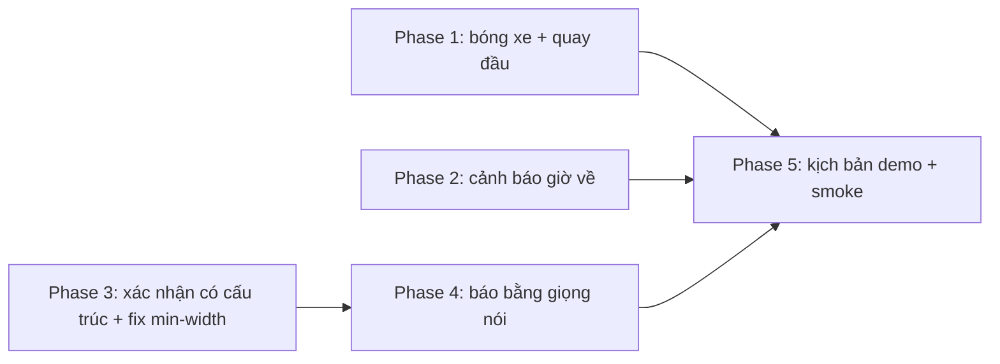

# Advise: 3 feature đáng tiền nhất cho demo Vào Được

## Reframing (user đã xác nhận)
- **Problem:** chọn 3 feature cho demo hackathon; team, > 1 tuần; demo kịch bản cố định trên khu demo + live; laptop + điện thoại; "wow trước, trung thực làm nền".
- **Requirements:**
  1. Mỗi feature demo trọn ≤ 90 s trên khu demo.
  2. Không feature nào đổi `strict`, `decisive_clearance`, `turn_verified`.
  3. Mỗi feature có đường lùi khi live lỗi (mạng, quota Gemini).
  4. Chạy trên trình duyệt điện thoại và laptop.
- **Non-goals:** ghi clip/dashcam, 3D tòa nhà, Street View.

## Chấm điểm (đã kiểm code)
| Ý tưởng | Wow demo | Tận dụng code sẵn | Rủi ro live | Giữ trung thực | Chọn |
|---|---|---|---|---|---|
| 1 Bóng xe + quay đầu | Rất cao (laptop) | `k_turn` đã tính pose rồi bỏ (`geometry.py:85-102`) | Thấp, tính local | Cần nét đứt + nhãn mô phỏng | **Có** |
| 2 Cảnh báo giờ về | Cao (điện thoại rung) | `timing.leave_before_at` sweep đã có (`plan.py:568-682`), mưa giả lập đã có (`App.tsx:79`) | Thấp, đổi mưa giả lập là ra | Dựa trên check ngập thật | **Có** |
| 4 Báo hẻm bằng giọng nói + xác nhận có cấu trúc | Cao | `/api/confirm`, `/api/blockage`, `reports.submit`, `_gate` | TB (STT, Gemini) → fallback chip | Qua operator duyệt; khép vòng "app không chắc → cộng đồng xác minh" | **Có** |
| 3 Hỏi Vào Được | Cao | `PlanRequest` | Cao: phụ thuộc LLM + geocode lúc demo | Dễ trượt sang LLM kết luận | Không |
| 5 Lưu ý khi đến | TB | Có | Thấp | Tốt | Không (gộp được sau) |
| 6 Hẻm quen | TB | Có | Thấp | Tốt | Không |
| 7 Clip | Cao | Không | Cao | — | Non-goal |

## Verdict
Chọn **#1 Bóng xe + mô phỏng quay đầu**, **#2 Cảnh báo giờ về**, **#4 Báo bằng giọng nói** (bên dưới là xác nhận có cấu trúc). Ba cái tạo một câu chuyện liền mạch: *trước khi đi* (thấy xe mình trong hẻm) → *đang đỗ* (điện thoại báo phải rời trước khi ngập) → *sau khi ra* (nói một câu, thành bằng chứng chờ duyệt). Cả ba đều dựa trên code có sẵn; không cái nào cần LLM để ra kết luận.

"Hỏi Vào Được" bị loại dù wow: nó là lớp nhập liệu thay cho form đang chạy tốt, rủi ro live cao nhất, và là nơi dễ để LLM "nói thay" planner nhất.

## Nên làm
1. #4 phải có **xác nhận có cấu trúc** làm lõi (vào được/chật/không + ra bằng cách nào; server tự tính way_ids đường vào/ra từ toạ độ điểm dừng). Giọng nói chỉ là cách nhập. Không có lõi này thì giọng nói là đồ chơi.
2. Sửa luôn lỗi thật: xác nhận "vào được" bằng hồ sơ nhóm đặt `lo = max_body + 0.2` (`evidence.py:491-492`); phải dùng thân hẹp nhất của nhóm (nhóm L: 1,74 thay vì 2,065 m).
3. #1 luôn vẽ theo `lo`, nét đứt khi `decisive_clearance=false`, nhãn "Mô phỏng · chưa phải bằng chứng". Khi `lo < three_point_width` thì hiện "Không quay được trong bề rộng thấp nhất đã biết" — trung thực và vẫn kịch tính.
4. #2 dùng Notification API phía client khi app đang mở (tab hoặc PWA đã cài); demo bằng cách bật mưa giả lập trên điện thoại.

## Không nên làm
- Không làm Web Push server (VAPID, scheduler) cho #2 trong vòng này: nặng hạ tầng, demo không cần.
- Không để LLM sinh text hiển thị kết luận; chỉ phân loại vào schema có sẵn.
- Không đổi `turn_verified` từ xác nhận tài xế, dù có nhiều xác nhận "quay đầu".
- Không bật 3D tòa nhà để "đẹp thêm".

## Rẻ hơn / hiệu quả hơn
- #2 không cần backend mới: gọi lại `/api/plan` với cùng request; so `timing.leave_before_at` và `verified` của stop đã chọn.
- #1 chạy hoàn toàn từ dữ liệu plan + một endpoint mô phỏng có cache theo (vehicle_id, width).
- #4 STT dùng Web Speech API của trình duyệt (miễn phí); Gemini chỉ một call phân loại; lỗi → chip chọn nhanh.

## Lộ trình

P1, P2, P3 song song được (file khác nhau, trừ `Result.tsx` — một người tích hợp).

## Benefits
- Mỗi feature có khoảnh khắc demo riêng trên đúng thiết bị: laptop (#1), điện thoại (#2, #4).
- #4 + fix min-width cải thiện dữ liệu thật, không chỉ demo.
- Không phá hợp đồng an toàn của nhánh hardening.

## Trade-offs
- #1 có thể bị hỏi "mô phỏng hành lang thẳng có đúng hẻm cong không?" → câu trả lời là nhãn và vẽ theo `lo`; nếu giám khảo coi đó là điểm yếu thì #1 mất wow. Đổi sang #5 khi đó tốn ~1 ngày.
- #2 chỉ báo khi app còn mở/được cài; không phải push thật. Nếu cần báo khi app đóng → thêm Web Push, +2–3 ngày.
- #4 phụ thuộc trình duyệt hỗ trợ `SpeechRecognition` tiếng Việt [INFERENCE: Chrome có, Safari iOS chưa chắc] → phải có ô gõ chữ.

## Work checklist
- [ ] P1: `geometry.k_turn_path` + endpoint `/api/vehicles/{id}/maneuver` + layer bóng xe/quay đầu
- [ ] P2: nút "Tôi đã đỗ ở đây", vòng kiểm tra lại, Notification, banner trong app
- [ ] P3: `Confirmation` gửi toạ độ điểm dừng + exit, server tính way_ids/way_out_ids, loader dùng thân hẹp nhất, `way_out.observed` trong plan
- [ ] P4: nút micro, STT, phân loại có `_gate`, chip fallback, flag `ai_voice_report`
- [ ] P5: kịch bản 3 × 90 s, smoke laptop + điện thoại, chế độ offline/fallback

## Success metrics
- `pytest backend/tests` xanh, có test mới chứng minh `compute_fit`/`_way_out` cho cùng `strict`, `turn_verified` khi có claim mới.
- Xác nhận "in" bằng `class-l` cho ra `lo = 1,74 + 0,2 = 1,94 m` (không còn 2,265).
- Bóng xe hiện trong ≤ 1 s sau khi chọn điểm dừng trên khu demo; mô phỏng quay đầu trả về trong ≤ 300 ms khi đã cache.
- Bật mưa giả lập → thông báo trên điện thoại trong ≤ 60 s.
- Nói "vào được nhưng phải gập gương, ra phải lùi" → report `confirmation` `tight`, exit `reversed`, trạng thái pending.
- Mỗi feature chạy hết kịch bản khi tắt mạng tới Gemini.
